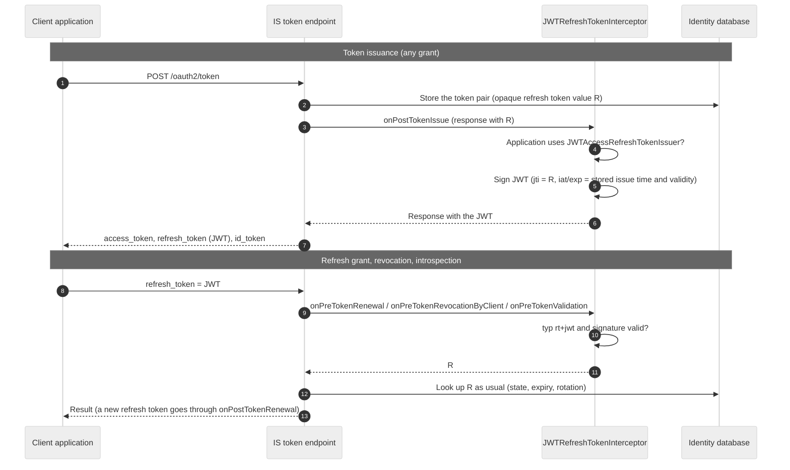

# Custom JWT Access and Refresh Token Issuer for WSO2 Identity Server

This repository contains a sample **OAuth token issuer** for WSO2 Identity Server (IS) 6.0.0 that issues **JWT access
tokens and signed JWT refresh tokens**.

In IS 6.0.0 every built-in token type (`Default`, `JWT`) issues an opaque refresh token, and the token response carries
no refresh token expiry. With this sample the client receives the refresh token as a signed JWT whose `exp` claim is
the expiry Identity Server enforces for it, so the client can read the expiry without calling the introspection
endpoint. Identity Server itself keeps storing and validating the refresh token exactly as it does for opaque refresh
tokens.

## Features

* **Signed JWT refresh tokens:** signed with the same key, algorithm and `kid` as the application's JWT access tokens,
  verifiable with the tenant's JWKS endpoint. The header type is `rt+jwt` and the claims follow the format later
  Identity Server versions use for their own JWT refresh tokens.

* **Nothing extra in the database:** Identity Server stores its usual opaque refresh token, which becomes the JWT's
  `jti`. The JWT is never stored, so token size, hashing and encryption of stored tokens are unaffected.

* **Unchanged token lifecycle:** rotation, replay rejection, expiry, revocation, introspection, and the return of a
  still-valid refresh token at sign-in work exactly as they do for opaque refresh tokens. `iat` and `exp` are the
  values Identity Server records for the stored token, so they always match introspection.

* **Per application:** applications opt in by selecting the token type. Applications on other token types are not
  affected, and switching an application between token types keeps its live tokens working.

* **All OAuth 2.0 and OpenID Connect flows:** authorization code (with or without PKCE, public or confidential
  clients), hybrid and implicit response types, password, device code and JWT bearer grants, with tenant and super
  tenant applications, legacy and tenant-qualified URLs, and local or federated (OpenID Connect and SAML) users.

## How it works

The sample has two parts:

* `JWTAccessRefreshTokenIssuer` is the token issuer registered as a token type. It extends the built-in
  `JWTTokenIssuer`, so access tokens and the opaque refresh token value Identity Server generates and stores are
  unchanged. It adds the code that signs and verifies the JWT form of a refresh token.
* `JWTRefreshTokenInterceptor` is an OAuth event interceptor. When the token endpoint returns a refresh token for an
  application whose token issuer is `JWTAccessRefreshTokenIssuer`, it replaces the stored value with a signed JWT whose
  `jti` is that value. When a client presents a JWT refresh token to the refresh grant, the revocation endpoint or the
  introspection endpoint, it verifies the signature and replaces the JWT with its `jti` before Identity Server looks the
  token up. Any other value is left unchanged.



## Token format

### Header

| Field | Value                                                                                           |
|-------|-------------------------------------------------------------------------------------------------|
| `typ` | `rt+jwt`. Deliberately not `at+jwt`, so a refresh token cannot pass as an RFC 9068 access token. |
| `alg` | The algorithm Identity Server uses for JWT access tokens (see [Signature algorithm](#signature-algorithm)). |
| `kid` | The key ID Identity Server puts in access and ID tokens for the signing tenant.                 |
| `x5t` | Thumbprint of the signing certificate.                                                          |

### Claims

| Claim        | Value                                                                                                              |
|--------------|--------------------------------------------------------------------------------------------------------------------|
| `iss`        | The issuer of the application's tenant, the same value as in its ID and access tokens.                             |
| `sub`        | The authenticated subject identifier, the same value as the access token `sub`.                                     |
| `aud`        | The issuer. A refresh token is only presented to Identity Server, and an audience other than the client ID keeps it from being mistaken for an ID token. |
| `azp`        | The client ID.                                                                                                     |
| `client_id`  | The client ID.                                                                                                     |
| `iat`, `nbf` | Issue time of the stored refresh token.                                                                            |
| `exp`        | Issue time plus the validity Identity Server stored for the token. Omitted when the refresh token does not expire. |
| `jti`        | The refresh token value Identity Server stores.                                                                    |
| `scope`      | The granted scopes, space separated, as in the access token. Omitted when there are none.                         |
| `aut`        | `APPLICATION_USER` for user tokens.                                                                                |
| `realm`      | `{"signing_tenant": "<tenant>"}`, only when tokens are signed with the user's tenant key (`[oauth.access_token] generate_with_sp_tenant_domain = false`), as Identity Server does for JWT access tokens. |

### Example (decoded)

```json
{
  "typ": "rt+jwt",
  "alg": "RS256",
  "kid": "NmU5ZmU1ZDM3ZDhh...YmI0ZA_RS256",
  "x5t": "NmU5ZmU1ZDM3ZDhh...YmI0ZA"
}
{
  "iss": "https://localhost:9443/t/example.com/oauth2/token",
  "sub": "7005a045-e53d-49ed-8f3f-52c48df85d23",
  "aud": "https://localhost:9443/t/example.com/oauth2/token",
  "azp": "OwQ_f6pnLxUu6jTIIwGQ_5mfYVMa",
  "client_id": "OwQ_f6pnLxUu6jTIIwGQ_5mfYVMa",
  "iat": 1790279934,
  "nbf": 1790279934,
  "exp": 1790366334,
  "jti": "51d9184b-ff92-34e6-85e7-85c898f6f1d5",
  "scope": "email openid profile",
  "aut": "APPLICATION_USER"
}
```

## Compatibility

* Built and tested against **WSO2 Identity Server 6.0.0**, update level 242 (OAuth component 6.8.0.49, authentication
  framework 5.23.8.205), on JDK 11, with PostgreSQL 17 and MySQL 8.4.
* The project compiles against the public 6.8.0 OAuth and 5.23.8 framework releases. The bundle imports the OAuth
  packages in the range `[6.8.0, 7.0.0)` and the framework packages in `[5.23.8, 6.0.0)`. Other versions have not been
  tested.
* Later Identity Server versions can issue JWT refresh tokens natively, as part of the non-persistent access token
  feature. Where that feature is available and supported for your deployment, prefer it to this sample.

## Relation to the product implementation

Later Identity Server versions issue JWT refresh tokens from the built-in `JWTTokenIssuer` when non-persistent tokens
are enabled and refresh token persistence is disabled. This sample follows that implementation for the token itself:
the same `rt+jwt` header, the same claims, the same subject, and the same signing key and `kid` as the access token.

It differs in the storage model. In the product feature the refresh token is not stored and the JWT is validated on
its own, with a list of revoked `jti` values. Here Identity Server keeps storing its usual opaque refresh token and
validating it by lookup, and the JWT carries that value as its `jti`. Everything that depends on the stored token
(expiry rules, rotation, revocation, the return of a valid refresh token at sign-in) therefore behaves as it does for
opaque refresh tokens.

## Build

```bash
mvn clean package
```

The bundle is written to `target/custom-jwt-access-refresh-token-issuer-0.1-SNAPSHOT.jar`. The build runs the unit and
integration tests (TestNG and Mockito): the issuer and the interceptor run against the real `JWTTokenIssuer` and OAuth
DTOs, with Identity Server's keystores, configuration and application lookups mocked. They cover every supported
algorithm, user tenant signing, tampered, unsigned and foreign tokens, error handling, and concurrent use from many
threads.

## Deploy and configure

1. Copy the jar to `<IS_HOME>/repository/components/dropins/` on **every node**.

2. Add the following to `<IS_HOME>/repository/conf/deployment.toml`:

   ```toml
   [[oauth.extensions.token_types]]
   name = "JWT_AT_RT"
   issuer = "org.wso2.support.sample.jwttokenissuer.JWTAccessRefreshTokenIssuer"
   persist_access_token_alias = true

   [[event_listener]]
   id = "custom_jwt_refresh_token_interceptor"
   type = "org.wso2.carbon.identity.core.handler.AbstractIdentityHandler"
   name = "org.wso2.support.sample.jwttokenissuer.JWTRefreshTokenInterceptor"
   order = 50
   enable = true
   ```

   * `persist_access_token_alias = true` matches the built-in `JWT` type: only the access token's `jti` is stored.
   * Enable the interceptor and register the token type together. With the token type but no interceptor, applications
     receive the opaque refresh token instead of a JWT.
   * If your `deployment.toml` also has an `[oauth.extensions]` table (for example, `token_persistence_processor`), it
     must appear **before** the `[[oauth.extensions.token_types]]` entries. In the other order the configuration
     mapper fails with a `StackOverflowError` and the server does not start.
   * Interceptors run from the highest `order` value to the lowest. No built-in interceptor reads refresh tokens, so the
     value is not critical.

3. Restart the server.

4. Select `JWT_AT_RT` as the token type of each application that should receive JWT refresh tokens: in the Management
   Console, open the service provider, go to **Inbound Authentication Configuration > OAuth/OpenID Connect
   Configuration > Edit**, and choose `JWT_AT_RT` under **Token Issuer**. Through the application management REST API
   it is `accessToken.type` of the OIDC inbound configuration.

The interceptor decides by the application's configured token issuer, not by the token type name, so the token type
can be registered under another name.

## Signature algorithm

Refresh tokens use the same algorithm as the JWT access tokens, which is a server-wide setting. Identity Server 6.0.0
supports `RS256`, `RS384`, `RS512` and `PS256` for JWT access tokens, and issues unsigned tokens with `NONE`.
Configuring an HMAC or ECDSA algorithm makes JWT access token issuance fail for every JWT token type, including the
built-in one, before this sample is involved.

In Identity Server 6.0.0 the algorithm setting is only read when the authorization context token is enabled, so both
keys are needed to change it:

```toml
[oauth.token.validation]
include_validation_context_as_jwt_in_reponse = true

[oauth.token_validation]
validation_response_signing_algorithm = "SHA512withRSA"   # SHA256withRSA, SHA384withRSA, SHA512withRSA, PS256 or NONE
```

Without them, JWT access and refresh tokens are signed with `RS256`.

## Behaviour and considerations

The behaviour below was tested end to end on IS 6.0.0 update 242, on PostgreSQL and MySQL, and compared with the
built-in `JWT` token type on the same server wherever Identity Server's own behaviour was involved.

| Scenario                                          | Result                                                                                      |
|---------------------------------------------------|---------------------------------------------------------------------------------------------|
| Authorization code, PKCE, public client, `form_post` | JWT refresh token issued; `exp - iat` equals the application's Refresh Token Expiry Time. |
| Hybrid (`code id_token`, `code token`, `code id_token token`) | The code exchange returns a JWT refresh token; the authorization endpoint returns none. |
| Implicit (`id_token`, `id_token token`, `token`)  | No refresh token is returned. A later sign-in with the code flow returns the refresh token Identity Server stored, as a JWT. |
| Password, device code, JWT bearer grants          | JWT refresh token issued.                                                                   |
| Client credentials grant                          | No refresh token is issued (server default), as with the built-in types.                    |
| Second sign-in while the token is valid           | The same refresh token (same `jti`) is returned, including on another node of a cluster.     |
| Refresh grant                                     | A new JWT refresh token; the old one is rejected with `invalid_grant`. With renewal disabled, the same token is returned. |
| Expired refresh token                             | `invalid_grant`, "Refresh token is expired.", as with opaque tokens.                         |
| Revocation and introspection                      | Work with the JWT, with or without `token_type_hint`; introspection `iat` and `exp` equal the JWT's. |
| Tampered, forged or unsigned refresh token        | `invalid_grant`.                                                                            |
| Refresh token used as a bearer token              | Rejected (UserInfo returns 401).                                                            |
| Password change, user deletion, My Account revocation, client secret regeneration | The refresh token is revoked, as with the built-in `JWT` type. |
| Federated users (OpenID Connect and SAML)         | Same ID token, access token and UserInfo claims as the built-in `JWT` type, at sign-in and after refresh. |
| Switching an application between token types     | Live tokens keep working; the format changes when the token is next rotated.                |
| Hashed or encrypted token storage                 | Same behaviour as the built-in `JWT` type; the database holds only the hashed or encrypted opaque value. |

Points to consider before using it:

* **The `jti` is the credential.** The JWT carries the stored refresh token value as its `jti`, so presenting the bare
  `jti` works exactly like presenting an opaque refresh token. The signature check rejects tampered or forged JWTs,
  but holding a JWT refresh token is equivalent to holding the opaque token it wraps. Protect it in the same way.
* **Signing key rotation.** After the signing key of a tenant changes, JWT refresh tokens signed with the old key no
  longer verify and are rejected with `invalid_grant`. The stored token is not affected: the next sign-in returns it
  signed with the new key.
* **Unsigned tokens.** With `NONE`, refresh tokens are unsigned like the access tokens, and an unsigned refresh token is
  accepted only while the server is configured for `NONE`.
* **Randomized signatures.** With `PS256`, the same refresh token returned twice (for example, with renewal disabled)
  has a different signature each time. Compare tokens by `jti`, not by string.
* **Whole seconds.** `iat` and `exp` are whole seconds. On databases that store timestamps in whole seconds (MySQL
  `TIMESTAMP`), they can differ from the original values by one second when Identity Server reads the token back.
* **Cost.** Every token response and every refresh adds one signature and one verification, in addition to the access
  token's signature.
* **Resource servers.** A resource server that validates JWT access tokens locally should check `typ` and `aud`, so it
  never accepts a refresh token signed with the same key.
* **Username assertion.** `[oauth.token_generation] include_username_in_access_token` appends data to issued tokens and
  is not supported with this sample.

## Verifying the deployment

1. Start the server with the OSGi console: `sh wso2server.sh -DosgiConsole`. Once it has started, press Enter and run:

   ```text
   osgi> ss custom-jwt
   45  ACTIVE  custom-jwt-access-refresh-token-issuer_0.1.0.SNAPSHOT
   osgi> bundle 45
   ```

   The bundle must be `ACTIVE`, and `bundle <id>` must list `org.wso2.carbon.identity.oauth.event.OAuthEventInterceptor`
   among its registered services. The bundle's activation message is often missing from the startup log even when it
   starts correctly, so do not rely on it.

2. Sign in with an application that uses `JWT_AT_RT` and decode the `refresh_token` from the token response. Its header
   must contain `"typ": "rt+jwt"`.

If applications on `JWT_AT_RT` receive opaque refresh tokens, check:

* that the `[[event_listener]]` entry is present and `enable = true`;
* the OSGi framework log, `<IS_HOME>/repository/components/default/configuration/<timestamp>.log`, for
  `[SCR] Exception while activating` lines that mention the bundle. A component activation failure (for example, a
  missing package import after modifying the code) is only logged there, not in `wso2carbon.log`;
* with `DEBUG` enabled for `org.wso2.carbon.identity.data.publisher.oauth`, the startup log lists each registered
  interceptor as `Setting OAuthEventListener : <class>`.

## Logging and debugging

Errors while signing a refresh token are logged at `ERROR` and returned to the client as `server_error`, so a client
never receives the stored value in place of the JWT. To see why a presented JWT was not accepted, or why a response was
left unchanged, enable `DEBUG` in `<IS_HOME>/repository/conf/log4j2.properties`:

1. Append `custom_jwt_token_issuer` to the list of loggers:

   ```properties
   loggers = AUDIT_LOG, ..., custom_jwt_token_issuer
   ```

2. Add the logger configuration:

   ```properties
   logger.custom_jwt_token_issuer.name = org.wso2.support.sample.jwttokenissuer
   logger.custom_jwt_token_issuer.level = DEBUG
   ```

## Disclaimer

This is a sample provided for reference. It is not part of the WSO2 Identity Server product and is not covered by
product updates. Review and test it against your own deployment before use.
